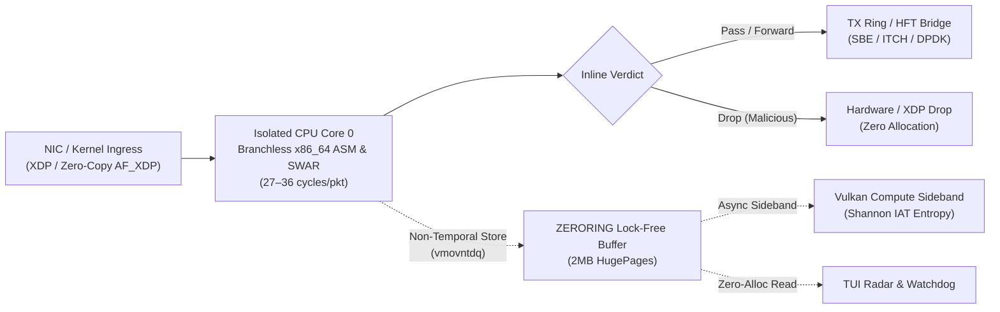
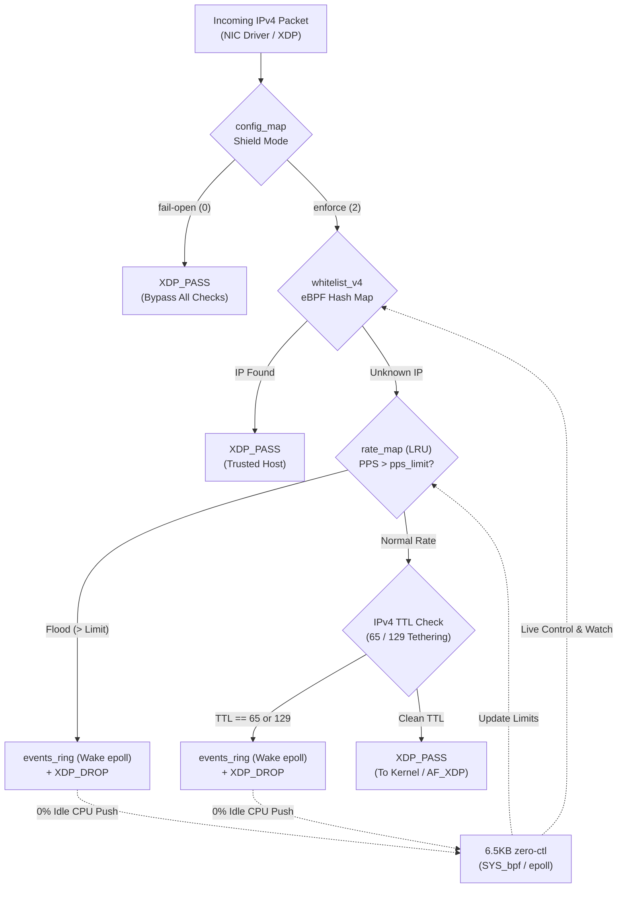
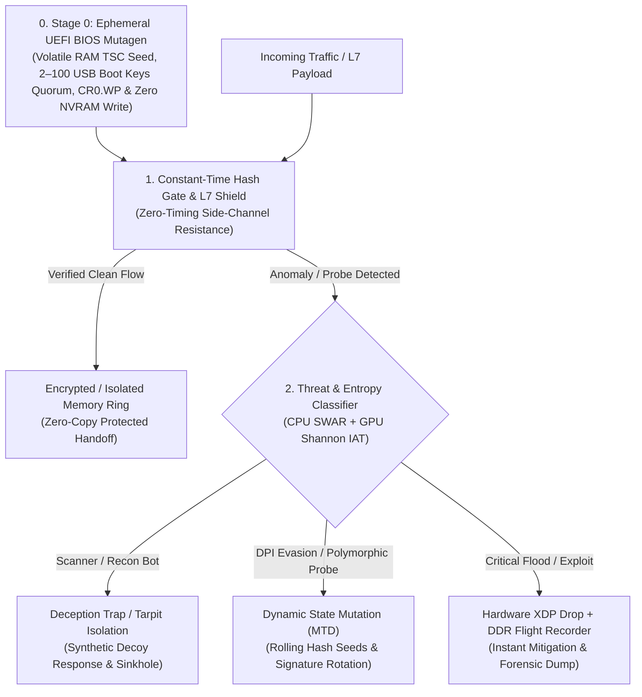

# Zero-Timing Manifesto


**Deterministic, ultra-low-latency `no_std` Rust (2024 Edition) data-plane core and `x86_64` bare-metal architectural blueprint.**

> **Language:** **English** | [Русская версия (`README.ru.md`)](README.ru.md)  
> **Hardware Logs:** Raw `lscpu`, `/proc/meminfo`, and execution telemetry are archived in [`docs/BENCHMARK_LOGS.md`](docs/BENCHMARK_LOGS.md).

## Data-Plane Packet Flow Architecture

# Compile & attach single-file ISP Anti-Tethering (TTL 65/129) XDP filter
clang -O2 -g -target bpf -c xdp_shield/isp_ttl65_shield.c -o xdp_shield/isp_ttl65_shield.o
# sudo ip link set dev <IFACE> xdp obj xdp_shield/isp_ttl65_shield.o sec xdp



### How the Dynamic XDP Checkpoint (TTL + Rate-Limit + `zero-ctl`) Works



## Active Security, Deception & Mutation Pipeline



## 1. Architectural Separation: Inline Fast-Path vs. Sideband & R&D

* **Inline CPU Fast-Path (`27–36 cycles/pkt`):** Branchless `x86_64` ASM L7 DPI (`cmov`), zero-copy `AF_XDP`, and `XDP` kernel ingress filtering make pass/drop decisions in nanoseconds with zero heap allocations.
* **Asynchronous GPU Sideband (`Out-of-Band`):** Vulkan Compute reads non-temporal `ZERORING` buffers (`vmovntdq`) in the background for Shannon IAT entropy analysis without adding latency to the packet path.

## 2. Hardware Cycle Benchmarks (`rdtscp + lfence`)

### Reference Testbed & Call for Hardware Benchmarks

All baseline numbers below were measured on a standard desktop workstation (**Intel Core i5-4590 Haswell, 3.30 GHz, AVX2 only / no AVX-512** + **NVIDIA GTX 1050 Pascal** for Vulkan Compute sideband):

* **Desktop Hardware Baseline:** XDP/AF_XDP benchmarks were executed without server-grade hardware `Intel DDIO` or native zero-copy server NIC drivers — meaning modern `Xeon Scalable` or `AMD EPYC` servers will achieve even lower cycle counts.
* **Community Call for `XDP_DRV` Tests:** Contributions from engineers with server NICs (**Intel X710 / E810**, **Mellanox ConnectX-5/6**) running native `XDP_DRV` zero-copy benchmarks via GitHub Issues or PRs are very welcome!

| Execution Layer / Component | Measured Latency | Measurement Methodology & Scope |
| :--- | :--- | :--- |
| **SMP 4-Core Matrix (`10M pkts`)** | **~0.5–0.6 ns/pkt** | Amortized aggregate throughput across 4 isolated cores (`align(4096)`, zero false-sharing) |
| **Bare-Metal Ring 0 Shield (`QEMU/OVMF`)** | **~27 cycles** | Amortized per-frame cost inside a warm packet batch (serialization outside inner loop) |
| **Branchless ASM L7 DPI (`TLS/HTTP/QUIC`)** | **30–36 cycles** | Warm L1 instruction cache batch inspection (`cmov` / SWAR, zero branches) |
| **Isolated L1 Cache-Line Read** | **~69 cycles** | Single cold call including full pipeline serialization (`rdtscp + lfence` overhead) |
| **GPU Sideband IAT Entropy (`Vulkan`)** | **48–66 CPU cycles** | Host CPU dispatch cost only (non-temporal ring write; GPU compute runs asynchronously) |
| **Native C-ABI Shared Lib (`10M pkts`)** | **~~12 ns/pkt** | Direct `gcc -O3` call into `libzero_cisco_daq.so` on 1 core (**~80 Mpps**, zero Python overhead) |
| **C-ABI Replay via Python FFI (`100k pkts`)** | **~820 ns (p50)** | End-to-end `libzero_cisco_daq.so` call overhead incl. Python `ctypes` FFI (`~0.83 Mpps`) |

## 3. Module Readiness Matrix

| Module / Directory | Status | Role & Technical Scope |
| :--- | :--- | :--- |
| `src/l7_shield.rs`, `src/ttl_guard.rs`, `src/af_xdp_engine.rs` | **Beta / Verified** | Branchless L3/L4/L7 SWAR inspection, self-learning `TTL` EMA guard & IPv4 whitelist |
| `xdp_shield/`, `cisco_daq_plugin/`, `hft_exchange_bridge/` | **Beta / Verified** | Linux kernel XDP hook, single-file ISP `TTL 65/129` shield & C-ABI `.so` plugins |
| `include/zero_timing.h`, `integrations/python/`, `integrations/go/` | **Beta / Verified** | Zero-dependency C/C++, Python (`ctypes`), Go (`mmap`) SDKs & `systemd` XDP unit |
| `src/numa_hugepages.rs`, `src/pcie_ddio_ptp.rs` | **Beta / Verified** | Raw syscall `2MB HugePages`, `NUMA MPOL_BIND`, Intel DDIO & PTP PHC reader |
| `ring_reader/zero_tui_radar.rs`, `src/runtime_guard.rs` | **Beta / Verified** | Zero-allocation live telemetry TUI radar, Watchdog & DDR Flight Recorder |
| `uefi_stage0/` (`BOOTX64.EFI`) | **Beta / Verified** | Bare-metal UEFI Ring-0 Unikernel, PCIe BAR0 NIC TX-DMA (`20 cycles/frame`) |
| `src/thin_hypervisor.rs` | **R&D Blueprint** | Hardware VT-x / AMD-V Ring -1 hypervisor skeleton |
| `zero-vault/` (`12 KB ELF`) | **Beta / Verified** | Zero-dependency `no_std` TOTP 2FA, `mlock()` RAM & USB Dead-Man's Switch |
| `tools/zero_ctl.rs` (`6.5 KB ELF`) & `sdk_template/` | **Beta / Verified** | Zero-dependency `no_std` eBPF controller (`stats`, `watch` via `epoll`, LRU rate-limit) & Rust+ASM+C SDK |

## 4. Building & Reproducing Benchmarks

```bash
# Run full end-to-end verification & benchmark suite
./demo_run.sh

# Run fast standalone integrity & branchless ASM audit
./verify_all.sh

# Build release core binary & pin to isolated CPU core 0
cargo build --release && taskset -c 0 ./target/release/zero_project

# Build C-ABI shared libraries (Cisco DAQ & HFT Exchange Bridge)
rustc --crate-type cdylib -C panic=abort -O cisco_daq_plugin/lib.rs -o cisco_daq_plugin/libzero_cisco_daq.so
rustc --crate-type cdylib -C panic=abort -O hft_exchange_bridge/lib.rs -o hft_exchange_bridge/libzero_hft_exchange.so

# Run offline PCAP / synthetic threat replay benchmark (no NIC/root required)
python3 tools/pcap_bench.py --count 100000

# Build 6.5KB zero-dependency no_std eBPF control CLI (stats, watch, allow, limit)
rustc -O -C panic=abort -C target-feature=-sse,-sse2 -C link-arg=-nostartfiles -C link-arg=-static -C strip=symbols tools/zero_ctl.rs -o target/release/zero-ctl
# Or replay a real .pcap capture file:
# python3 tools/pcap_bench.py --pcap capture.pcap
```

## 5. Dual Licensing & Commercial Support

* **Open-Source (`GPL-3.0`):** Free for research, auditing, and open-source deployments under [`LICENSE`](LICENSE).
* **Commercial Integration:** Proprietary integration without `GPL-3.0` copyleft obligations is available via [GitHub Issues](https://github.com).
---

### Support the Project
If you would like to support further research and help me build a dedicated **bare-metal testbed rack** (1U/2U Xeon/EPYC server + 10G/25G XDP NICs for real DDIO & line-rate benchmarks), you can send **TON** or **USDT (TON network)**:
```text
UQBTjCDPiQIUl73F_1f-3ArppvjdfJ7mfONIyfDZl5d9z66Z
```
### Honest Hardware & Silicon Boundaries (What Software Alone Cannot Solve)
* **Sub-Ring 0 Firmware (`Intel ME / AMD PSP`):** Cannot be disabled from a running OS or Unikernel; requires SPI-flash neutralization (`me_cleaner` / `HAP` bit) and hardware `SMRAM` locking (`D_LCK`).
* **Proprietary Hardware Specs (`Closed GPUs / Wi-Fi`):** Bare-metal `Ring 0` drivers target open-register NICs (`Intel e1000 / ixgbe / E810`); proprietary GPUs remain isolated in user-space via non-temporal `ZERORING` (`vmovntdq`).
* **Physical Cryogenic DDR Attacks (`Cold Boot`):** Desktop DDR modules retain charge after power loss unless keys are bound inside CPU silicon registers (`YMM15` TRESOR-mode in `zero-vault`) or protected by server **Intel TME / AMD SME**.

---

## 6. Enterprise Products & Commercial Pilots (B2B)

For production deployments, commercial licensing (without GPL-3.0 copyleft), and 14-day PoC pilots, see **[Enterprise Solutions & Deployment Guide](docs/ENTERPRISE_SOLUTIONS.md)**:

* **Zero-Shield (Telecom, Hosting & Anti-DDoS):** Line-rate XDP ingress filtering, anti-tethering TTL guard, and drop-in Snort/Suricata C-ABI accelerator (`libzero_cisco_daq.so`).
* **Zero-Bridge (HFT & Fintech):** Zero-allocation `no_std` market data parser (SBE/ITCH) with C-ABI (`libzero_hft_exchange.so`), 2MB HugePages, and PTP hardware timestamping.
