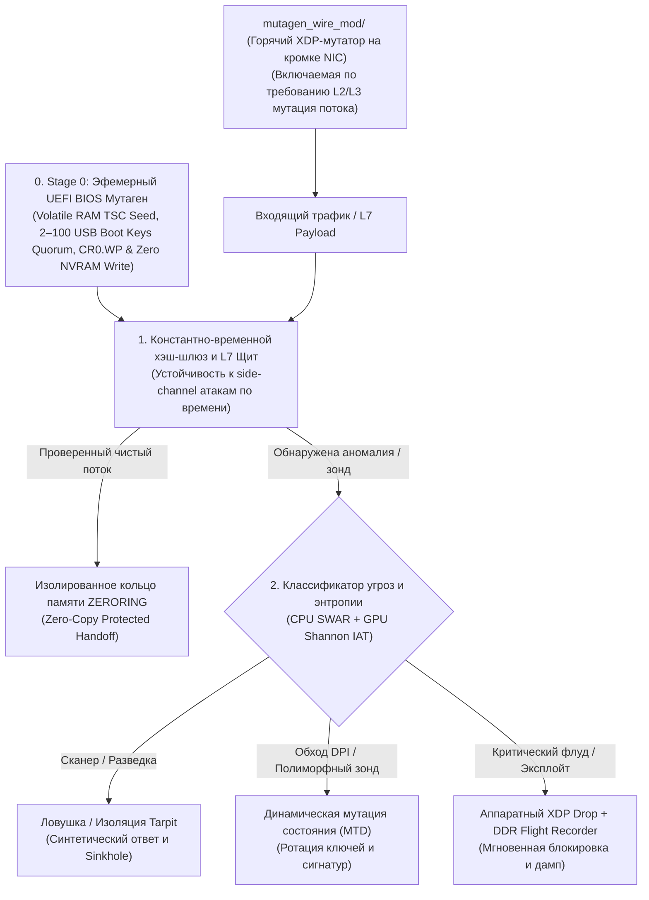

# Zero-Timing Manifesto (Русская документация)

## Конвейер активной защиты, обмана и мутации трафика

Детерминированное сверхнизколатентное ядро обработки сетевого трафика на `#![no_std]` Rust и `x86_64` Inline ASM. Подробную техническую документацию, замеры производительности на Intel Core i5-4590, архитектурные модули и реквизиты поддержки проекта вы можете найти в исходном файле репозитория.

## Актуальные стресс-тесты и новые модули (14.11.2026)
* **Нативный 4-ядерный потолок (500 000 000 кадров, 2 МБ L3/UMEM кольцо):** **42.36 Mpps** (**28.5 Гбит/с** на минимальных 64-байтных кадрах, **23.61 нс** на кадр) на Intel Core i5-4590 при температуре +37 °C.
* **Холодный RAM + TLB Thrashing (512 МБ пул из 65 536 страниц с ловушками `mprotect(PROT_NONE)`):** **34.92 Mpps** (**28.64 нс/кадр**, **0 SIGSEGV**).
* **Guard-Page структурный фаззинг (2 500 645 мутированных TCP/TLS/QUIC кадров на невыровненных адресах у границы `PROT_NONE`):** **0 выходов за границы памяти**, 0 гонок данных в 4 потоках.
* **Автономный XDP-модуль `mutagen_wire_mod/`:** подключаемый по требованию (`mutagen-ctl on/off`) L2/L3 потоковый мутатор трафика на границе сетевого интерфейса (`XDP`) с нулевым байпасом в штатном режиме.
